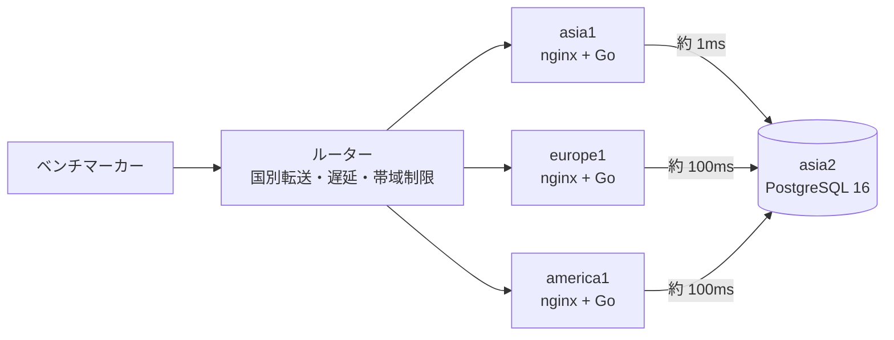

## はじめに

2026年10月31日（土）に開催された ISUCON2026 に、チームメイトと2人で参加しました。最終スコアは **100,655**、順位は **135位** でした。

今回は、競技中の作業の進め方を「GitHub の Issue に課題を書き、Claude Code に PR を作らせ、人間がレビューしてリリースする」というやり方に寄せました。この記事は、その進め方と、実際に効いた改善・効かなかった改善を、リポジトリの Issue と PR をたどって記録したものです。

先に数字をまとめます。

| 項目 | 値 |
|---|---|
| 最終スコア | 100,655（135位） |
| 最初の負荷走行 | 約 3,000 |
| 作成した Issue | 76 件 |
| マージした PR | 57 件 |
| マージした PR の差分 | +21,930 / −3,708 行 |
| Go のテスト関数 | 201 個 |
| `/api/initialize` の申告 | `agent: claude`、`harness: claude-code`、`model: claude-opus-5-5` |

## 問題：ISUReal

お題は、日常の写真を友達と共有する SNS「ISUReal」でした。投稿期間（posting window）が開くと利用者に SSE で通知が届き、利用者が写真を投稿し、友達の写真を閲覧してコメントや RealMoji（顔写真でのリアクション）を送る、という流れです。

今年の特徴はサーバ構成です。

| サーバ | リージョン | 初期状態の役割 |
|---|---|---|
| asia1 | asia | nginx、Go アプリ |
| europe1 | europe | nginx、Go アプリ |
| america1 | america | nginx、Go アプリ |
| asia2 | asia | 共有 PostgreSQL 16 |

全台 2 コア、メモリ 3.7GiB です。リクエストは `X-Country-Code` ヘッダに応じてルーターが各リージョンのサーバに転送し、リージョン間の通信には遅延と帯域制限があります。実測では europe1 / america1 から asia2 の DB への往復は **約 100ms** でした。一方、europe と america のスコアには **1.5 倍** の倍率がかかります。

つまり「DB が asia にしかないのに、点の高い利用者は海の向こうにいる」という構図で、**リージョンをまたぐ DB の往復回数**が最初から最後まで主題になりました。

また、マニュアルには `/api/initialize` の応答に使った AI エージェント・ハーネス・モデルを申告する欄があり、AI によるコード生成が明示的に許可されていました。

## 進め方

### 競技開始からリリースまでの流れ

1. **環境構築**：CloudFormation で 4 台を立て、SSH 接続と EBS の初期化を確認。マニュアル通りに負荷走行を 1 回実行（約 3,000 点）
2. **コードを GitHub へ**：サーバ上の `~/webapp` は git 管理されていなかったので、Go 実装・SQL・nginx / PostgreSQL / systemd の設定・マニュアルをまとめて private リポジトリに push
3. **Issue を書く**：Claude Code にコードとマニュアルを読ませ、ボトルネックの見立てと子 Issue を親 Issue（#16）にまとめる
4. **PR を作る**：Issue ごとに Claude Code が PR を作り、ローカルの `postgres:16` コンテナと同一性テストで確認
5. **リリース**：手順を Issue（#21）に書き、手元の Mac から Linux バイナリをビルドして rsync、再起動、ポータルで負荷走行
6. **結果を Issue に記録**：スコアと `pg_stat_statements` などの差分を親 Issue のコメントに残し、次の Issue を切る

チームメイトは、nginx のアクセスログを alp で集計した結果や、`pg_stat_statements` / `pg_stat_user_tables` から見える重いクエリとフルスキャンを Issue にまとめる役を担ってくれました（#25、#35、#36、#51 など）。私はそれを受けて Issue を細かく切り、Claude Code に PR を作らせ、レビューとリリースを回しました。

### 当日のタイムライン（JST）

| 時刻 | できごと | スコア |
|---|---|---|
| 09:53 | 初期コミット（環境構築後にコードを push） | 約 3,000 |
| 11:59 | 計測・DB 接続・インデックス・キャッシュなど 14 件の子 Issue を起票（#2〜#15） | |
| 12:50 ごろ | 段階 1〜3 のリリース（計測、接続プール、インデックス、画像キャッシュ、SSE ハブ、フィードの SQL 化） | 11,798 |
| 13:10 | ロック競合の緩和（#28） | 20,094 |
| 14:14 | エクスポート・画像取得・セッションキャッシュ・初期化の改善 | 28,118 |
| 14:40 ごろ | Memories と投稿の関数化を反映 → asia2 が **OOM で FAIL** → asia2 のアプリ振り分けを撤回 | 37,550 |
| 14:58 | IP BAN の読み直しの分離、フィードの 1 クエリ化 | 43,285 → 48,652 |
| 15:10 ごろ | gzip 圧縮を反映 → 再び asia2 が **OOM で FAIL** → DB 接続数の上限を設定 | 48,258 |
| 16:00 ごろ | 署名計算の削減、SSE、posting window の関数化、`/api/me` のキャッシュなど 11 件 | 63,120 |
| 16:40 | synchronous_commit、nginx keepalive、JPEG 検証キャッシュ、画像読み込みのまとめ | 61,205 |
| 16:57 | nginx のチューニング、指標の公開、GOAMD64=v3、ポーリング削減など 7 件 | 64,419 |
| 17:01〜17:07 | DB 接続数の配分を実験（下がったので戻す） | 62,370 / 53,947 |
| 17:17 | 画像列の STORAGE EXTERNAL、Memories の部分索引、セッション確認の専用接続 | |
| 17:34 | 不要なログ・計測を止める、asia1 の CPU 上位 2 つ（HMAC、JPEG）を削減 | |
| 18:00 | 競技終了 | **100,655** |

17:00 のリーダーボード凍結後は自チームの結果だけが見えるため、最後の 2 回のリリースのどちらがどれだけ効いたかは切り分けていません。

## 最初の見立てと計測

Claude Code にコードとマニュアルを読ませて立てた見立ては、次の 3 つでした。

1. europe と america のアプリから asia2 の DB へ、リージョンをまたいで何度も往復している
2. 画像署名の計算（HMAC-SHA256 を 1,000 回）と、画像本体のリージョン間転送
3. フィードが開いている投稿期間の投稿を全件取得し、Go 側で絞り込んでいる

ただし、推測で書き換える前に計測を入れることにし、P0 の Issue を「計測環境を整備する」にしました。nginx のアクセスログを alp で集計できる形式にし、Go アプリに `net/http/pprof` を足し、PostgreSQL に `pg_stat_statements` を入れました。

計測して分かったことのうち、方針を決めた 2 つを挙げます。

**1 リクエストあたりの往復回数**。`pg_stat_statements` の文の数をリクエスト数で割ると平均 5.5 往復でした。コードから数えると投稿は 9 往復で、そのうち 5 往復は投稿期間の行のロックを持った状態でした。europe からの投稿は「約 100ms × 往復回数 ＋ ロック待ち」で 1 件 900ms 以上かかり、投稿期間ごとに 1 行しかない `posting_windows` の `FOR UPDATE` のせいで、**1 リージョンで毎秒 2 件ほどしか投稿できない**状態でした。

**時間を使っているのはロック待ち**。チームメイトがまとめた「累計実行時間の長いクエリ TOP 10」は、どれも 1 回の読み込みが 3〜8 ブロックしかなく、時間のほとんどがロック待ちでした。インデックスが足りないのではなく、ロックを持ったまま海を渡る往復をしていたのが原因です。

## 効いた改善

### ロックの粒度と持つ時間を減らす（#28）

- 投稿で、画像の `INSERT` をユーザーと投稿期間をロックする**前**に移動。受け付けなかった場合はロールバックで画像も消える
- 投稿期間の行のロックを `FOR UPDATE` から `FOR SHARE` に変更。同じリージョンの投稿が並行して進む
- RealMoji とコメントで、投稿者の行は `FOR SHARE`、送った人の行だけ `FOR NO KEY UPDATE`
- 登録と投稿期間の開始で使っていた `LOCK TABLE users` を廃止

反映後、`posting_windows ... FOR UPDATE` の平均 697ms が 0.0ms に、`LOCK TABLE users` の 731ms はなくなり、スコアは 11,798 から 20,094 になりました。

### ロックから確定までを PL/pgSQL の関数 1 回にする（#43、#54、#77、#80、#91）

ロックを持った状態で 100ms の往復をするのが問題なので、「ロックの取得から COMMIT まで」を DB の関数にまとめ、autocommit の 1 文で呼ぶようにしました。投稿は 9 往復が 2 往復（セッション確認と関数呼び出し）になり、ロックを持つのは関数の実行中の数 ms だけになります。

CTE で 1 文にまとめる案は採りませんでした。READ COMMITTED でも CTE は文の開始時点のスナップショットで数えるため、「本人の行のロックを待ったあとに、その日の件数を数える」という順序が守れず、同じ人の同時投稿で「1 日 1 件」が破れるからです。PL/pgSQL の関数なら文ごとに新しいスナップショットが取られます。

同じ考え方で、友達申請・フォロー・ブロック、登録・ログイン・プロフィール変更・退会、投稿の編集・削除、投稿期間の開始も関数化しました。

### セッションキャッシュで認証の往復をなくす（#46、#79、#92）

europe と america では、すべての API が `SessionMiddleware` で DB に 1 往復していました。これを TTL 400ms のプロセス内キャッシュにしました。正しさの根拠は次の通りです。

- キャッシュを持つプロセスは 100ms ごとに、持っている全トークンを 1 クエリでまとめて確かめ直す
- セッションを無効にする操作（ログイン、ログアウト、退会、リージョン変更）は、コミットしてから TTL だけ待って応答する
- すると、書いた側が応答した後のリクエスト時刻 r は r > c + TTL（c はコミット時刻）で、使えるエントリの検証時刻は r − TTL より後、つまりコミットより後に送られたクエリのもの。古いセッションを有効と判定することはない

時計の同期は不要で、各プロセスの単調時計だけで成り立ちます。あとから、そのリージョンをキャッシュしているプロセスが自分だけなら TTL 待ちを省く設定（#79）と、`GET /api/me` も本人の行をキャッシュから返す変更（#92）を足しました。

### 読み取り系を 1 クエリにまとめる（#22、#53、#57、#80、#81、#89、#123）

フィードは「閲覧者の状態・ブロック・友達・友達の友達」を読む往復と、候補の投稿を読む往復に分かれていました。CTE で閲覧者の関係を求め、候補の投稿と同じクエリで返すようにし、friends-of-friends のスコアに使う数も同じクエリで数えるようにしました。Memories、プロフィール、RealMoji・コメントの一覧、エクスポートも同様です。

書き換えの前後で結果が同じことは、旧実装を残した同一性テスト（`-tags equivalence`）で、合成データ 80〜250 人分のフィード 4 種を比較して確かめました。

### 画像まわりのキャッシュ（#18、#48、#82、#105、#113）

- 画像署名（HMAC-SHA256 × 1,000 回）の結果と、画像本体をアプリのメモリにキャッシュ（上限 512MB）
- 署名付き URL を作る時点で画像の所有者の鍵を記録し、取得時の DB 往復を減らす
- 画像の有効性（投稿の削除から 5 秒以内に取得できなくする）の確認を取得の処理から外し、無効化を一括で検知する
- JPEG の検証結果を画像のハッシュで覚え、同じ画像を 2 回デコードしない
- キャッシュにないときの読み込みをまとめ、同じ画像の同時取得を 1 回にする

### SSE 通知をプロセス内のハブ 1 本にまとめる（#19、#78、#90、#122）

初期実装は SSE の接続ごとに 100ms のポーリングで DB を叩いていて、alp の集計では `GET /api/notifications` が合計時間の大半を占めていました。接続ごとのポーリングをプロセス内のハブ 1 本にまとめ、投稿期間の開始は `LISTEN/NOTIFY` で検知し、通知は全員分を 1 クエリで引いて各接続に渡すようにしました。nginx の `proxy_read_timeout` も 1 時間に延ばしてつなぎ直しを減らしています。

### nginx と PostgreSQL の設定（#17、#75、#96、#103、#104、#114）

- nginx：API の JSON 応答を gzip 圧縮、アプリへの接続を keepalive、画像とエクスポートの応答をバッファせずに流す、`worker_connections 8192`、`multi_accept`
- PostgreSQL：`shared_buffers = 1GB`、`max_connections = 256`、`jit = off`、`synchronous_commit = off`

`jit = off` は、推定コストが大きいクエリで毎回 JIT コンパイルが走り、13〜133ms かかっていたためです。`synchronous_commit = off` は、追試で「負荷走行で書き込んだデータが再起動後に取得できること」が確認されるため最初は見送り、正常な再起動では失われないことを確認してから入れました。

### asia1 の CPU を減らす（#88、#117、#134）

後半は asia1 の Go アプリが 2 コアを使い切るのが律速になりました。負荷走行中の 30 秒プロファイルを取ると、上位は画像署名の HMAC（45%）と JPEG の検証（30%）で、JSON のエンコードや GC は上位に出ませんでした。

- **HMAC を 8 本ずつまとめて計算**：asia1 の CPU（Xeon 8275CL）には SHA の専用命令がなく AVX-512 はあるので、8 本の HMAC の連鎖を YMM の 8 レーンで同時に進めるアセンブリを生成しました。64 枚の署名が 28.8ms から 4.9ms になります。署名の値と形式は変えていません
- **JPEG の検証で画素を復元しない**：Go 標準の `image/jpeg` をコピーし、逆量子化・逆 DCT・色変換を取り除いた検証専用パッケージを作りました。`jpeg.Decode` と同じ成否・エラー文・サイズを返すことを、Go のテストデータと壊した画像約 1.8 万件、ファズ約 67 万回で確認しています
- `GOGC=400`、`GOMEMLIMIT=2GiB` で GC の回数を減らし、`GOAMD64=v3` でビルド

## 失敗と学び

### asia2 の OOM で 2 回 FAIL した

1 回目は、asia2 で Go アプリも動かして asia のリクエストを振り分ける構成（#31）を入れたあとに起きました。PostgreSQL が OOM killer に終了され、さらに systemd の `OOMPolicy=stop` で停止処理が止まり、手動で復旧しました。振り分けはやめ、asia2 は DB 専用に戻しました。

2 回目は、gzip 圧縮を入れた直後です。原因は圧縮ではなく、3 台のアプリの接続プールの合計が 192 本まで増え、1 接続あたり約 12MB ＋ `shared_buffers` 1GB ＋ ページテーブル約 400MB でメモリを使い切ったことでした。`ISUREAL_DB_MAX_CONNS` を asia1=24、europe1=40、america1=40 の合計 104 本に抑え、asia2 に `OOMPolicy=continue` の drop-in を足しました。

メモリ 3.7GiB の DB サーバで、接続数の上限をアプリ側で決めていなかったのが反省点です。接続プールを起動時に温める PR（#76）は、上限まで接続を作ってしまうので、この時点で保留にしました。

### DB 接続数の配分は「待ち時間」ではなく「スコア」で判断する

接続プールとキャッシュの指標を `/debug/vars` で公開し（#116）、負荷走行中に 5 秒ごとに記録しました。asia1 は 24 本の接続が約 40 秒間すべて使用中で、1 回あたり 209ms 待っていたので、asia1=40、europe1=america1=32 に変えてみました。

| | 24 / 40 / 40 | 40 / 32 / 32 |
|---|---|---|
| スコア | 62,370 | 53,947 |
| 3 台の待ちの合計 | 7,052 秒 | 4,237 秒 |

待ちの合計は 40% 減ったのに、スコアは 13.5% 下がりました。asia2 では同時に実行中のクエリが 23 本に増え、ロック待ちが出て、CPU の空きが 0% になっていました。DB 側がボトルネックのときに接続を増やしても、待つ場所がアプリから DB に移るだけでした。設定は元に戻しました。

### 累計の統計に惑わされない

`pg_stat_user_tables` の Seq Scan の件数（realmojis で 5.7 億行など）は、DB を作ってからの累計です。インデックスを追加した後に見ても、追加前の分が含まれています。チームメイトの提案したインデックスの大半は既に入っていたので、EXPLAIN で今のクエリがインデックスを使っていることを確かめて見送りました。以降は負荷走行の前に統計をリセットし、1 走行分だけで前後を比べるようにしました。

### 複数 PR を同時にリリースすると切り分けられない

時間が限られていたので 4〜11 件をまとめてリリースすることが多く、どれが効いたかは分かりません。16:40 の 61,205 は前回の 63,120 より約 3% 低く、走行ごとのばらつきかどうか判断できませんでした。ばらつきは同じ設定で 2 回走って約 3% だったので、それより小さい差は信用しないことにしました。

### 本番のライブ走行中に再起動してしまった

ポータルの負荷走行は、アイドルを確認した直後に始まることがあります。ロードアベレージだけでなく、journal の操作ログの行数で走行中かを確かめてから再起動するようにしました。

## やり残したこと

- **asia2 でもリクエストを処理する**（#97）：asia1 の CPU が張り付く一方で asia2 の CPU には余裕があったので、asia の 20% ほどを asia2 に振る案。OOM で一度撤回したあと、メモリの見通しが立たず再挑戦できなかった
- **asia でもセッションキャッシュを有効にする**（#126）：手順とテストは用意したが、実機での判断と反映まで至らなかった
- **`GET /api/posting-window/current` の DB 往復をなくす**（#128）
- **PGO**：負荷走行中のプロファイルを `default.pgo` として置く手順は書いたが、ビルドに組み込む時間がなかった
- **TCP のスロースタート**（#69）：画像 1 枚の取得が 1 回目 517ms、2 回目 136ms と差があり、`tcp_slow_start_after_idle` の影響が疑われるが、運営への確認を含めて手を付けていない

## Claude Code との進め方で良かったこと

- **Issue を小さく、受け入れ条件つきで書く**。「まず測ってから」「変えてはいけないこと」（画像は DB に置いたまま、署名の形式と検証結果は変えない、`canView` を緩めない、削除から 5 秒以内に画像を取得できなくする、など）を親 Issue に列挙し、各 Issue から参照しました。これがあると、PR が規約違反に踏み込みません
- **同一性テストを先に書かせる**。書き換えの前に旧実装を残した比較テストを作り、合成データで一致を確かめてから本番に出す。FAIL は 0 点なので、速さより「同じ結果を返すこと」の確認に時間を使うのが結果的に速かった
- **ルール上の判断を docs に残す**。asia2 でアプリを動かしてよいか、`synchronous_commit = off` は追試に耐えるか、といった判断は、マニュアルの該当箇所を引いた表にして `docs/` に残しました。あとから見直すときに迷いません
- **リリース手順と結果を Issue に書く**。バックアップのコマンド、ロールバックの方法、確認項目を Issue に書いておくと、焦っているときに手が止まりません。スコアも Issue のコメントに残したので、この記事がリポジトリだけから書けました
- **PR の説明に「変更前と同じ結果になる根拠」を書かせる**。レビューはここだけ読めば判断できます。CTE ではなく PL/pgSQL にした理由のような、後から効く判断がここに残っています

一方で、PR の数が増えるとマージの順序と衝突の管理が人間側のボトルネックになりました。「触るファイルが重ならないように Issue を切る」ことを意識して、PR の説明にも「ほかの PR と重なるファイルはない」と書かせていました。

## おわりに

スコアは 3,000 から 100,655 まで伸びましたが、順位は 135 位で、上位との差は大きいです。振り返ると、後半の asia1 の CPU 不足が見えた時点で asia2 のアプリ活用に再挑戦する判断ができていれば、もう一段伸びた気がします。

とはいえ、「計測 → Issue → PR → リリース → 記録」のループを 8 時間で 57 周回せたのは、Claude Code に PR とテストを任せ、人間はレビューと本番の判断に集中するという分業がかみ合ったからだと思います。来年は、メモリと接続数の見積もりを最初の Issue に入れるところから始めます。
